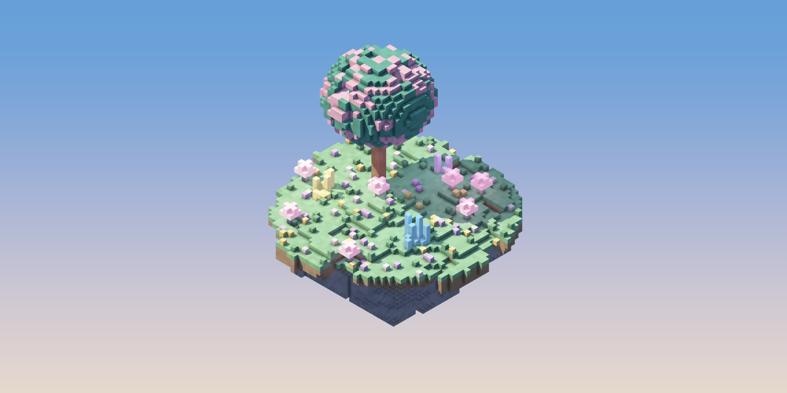

<picture>
  <source media="(prefers-color-scheme: dark)" srcset="terrarium/banner-night.png">
  
</picture>

# Antonio Mancini

Full stack software engineer in Rome. I work on web and mobile apps and on AI applications, and I like
building tools that make agent-written code easier to verify.

## Projects

- **[Tameki](https://github.com/antomanc/tameki)**: Android app for expenses and subscriptions that works offline, with no account. Shows where you can save. Kotlin, Jetpack Compose.
- **[wellkept](https://github.com/antomanc/skills)**: an agent skill that turns the mistakes AI agents keep making in a repo into checks that fail the build. Works with Claude Code, Codex and Cursor.
- **[vegdex](https://vegdex.antomanc.com)**: vegan recipe search by ingredient, meal and cooking time, with shopping lists and offline use. Svelte, TypeScript.
- **[Niche Game](https://nichegame.antomanc.com)**: realtime multiplayer game with server-authoritative state. An LLM validates answers; application rules decide the score. Next.js, TypeScript.

Also: [Ameki](https://github.com/antomanc/ameki) (Android weather app with Material You widgets),
[TrainerBridge](https://github.com/antomanc/TrainerBridge) (ESP32 bridge to share one smart trainer between Zwift and a Garmin),
[terrarium](https://github.com/antomanc/terrarium) (the image above: your GitHub year as a voxel island).

[Portfolio](https://www.antomanc.com) · [LinkedIn](https://www.linkedin.com/in/antomanc/) · [X](https://x.com/antomanc25)
